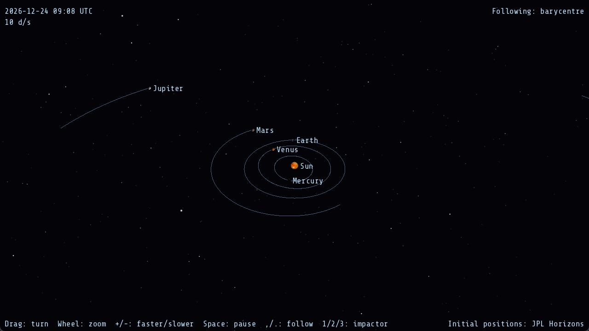
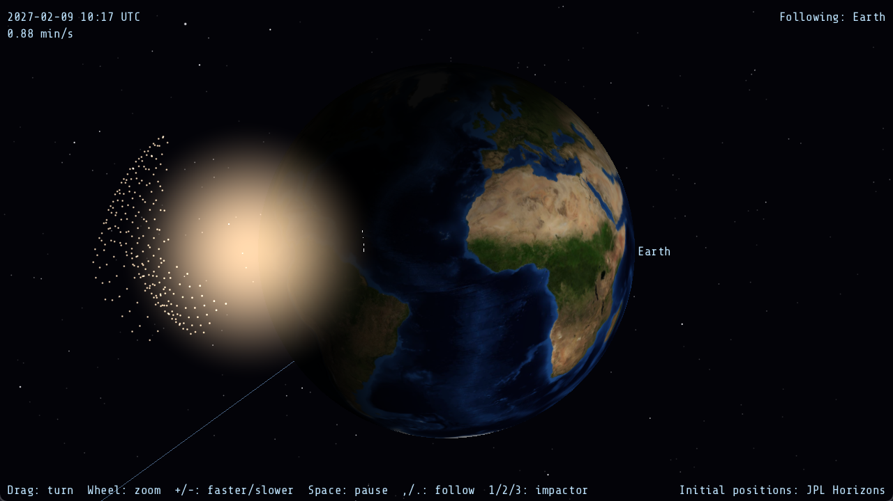

# Astronomical System

A real-time N-body simulator of the solar system, written from the ground up in **Java** on
**OpenGL 3.3 core**: no game engine, no scene graph, no math library. It starts from the real
positions of the planets today, taken from NASA JPL Horizons, integrates Newtonian gravity with a
symplectic scheme, and lets you throw asteroids and protoplanets at the planets to watch them merge
or shatter according to published scaling laws for planetary collisions.





## What it does

- **Starts from the sky of today.** Barycentric state vectors of the Sun and the eight planets
  are queried from the [JPL Horizons API](https://ssd.jpl.nasa.gov/horizons/) at launch. Without a
  network the application falls back to Keplerian elements propagated to the current date, and the
  head-up display tells which of the two it started from.
- **True N-body gravity in physical units**: astronomical units, days and solar masses, with the
  Gaussian gravitational constant. Nothing is scaled or faked: the Sun moves around the barycentre
  like every other body.
- **Predicted paths.** Every body shows where it will be over the next year, obtained by running
  a copy of the simulation ahead of time.
- **Impacts with physical outcomes.** Collisions are detected along the whole time step, not just
  at its end, so nothing tunnels through a planet. Slow encounters merge; faster ones follow the
  scaling laws of Leinhardt and Stewart: a largest remnant plus fragments that conserve mass,
  momentum and centre of mass.
- **An impact you can watch.** When the followed body is hit, time slows down by itself and the
  impact unfolds: a fireball sized by the energy of the collision that cools from white to red, and
  a plume of embers on ballistic arcs that fall back to the surface.
- **A camera that goes from 100 AU to the surface.** Orbit, zoom and follow any body down to two
  of its radii; bodies are spheres lit by the Sun, with a day side, a night side and a limb-darkened
  star.

## Built at a low level

Everything below the window is written in this repository. The only runtime dependency is
[LWJGL 3](https://www.lwjgl.org/), used as a thin binding to GLFW, OpenGL and stb.

| Area | How it is done |
| --- | --- |
| Rendering | OpenGL 3.3 core profile, forward compatible. Hand-written GLSL 330 shaders, vertex arrays and interleaved streamed buffers. |
| Camera | No matrix library. The look-at basis and the perspective projection are computed on the CPU in double precision, and the GPU receives clip coordinates. At solar-system scale a planet is 10⁻⁵ AU wide one AU from the origin: single-precision world coordinates would make it jitter. |
| Spheres | Impostors: each body is a camera-facing quad of two triangles; the fragment shader rebuilds the normal of the sphere, `(x, y, √(1 − x² − y²))`, and shades it with Lambert's law, or with linear limb darkening for a star. A planet costs six vertices at any zoom. |
| Lines | Predicted paths are line strips clipped by OpenGL in homogeneous coordinates, before the perspective division, so a path that passes behind the eye is cut and never drawn mirrored. |
| Light effects | Additive blending with the depth test on and depth writes off: glows are hidden by nearer bodies and hide nothing. |
| Text | A font atlas baked at start-up with `stb_truetype`; own layout for the head-up display and the labels that follow the bodies. |
| Depth range | The near plane follows the camera, so that the same lens frames Neptune's orbit and a crater. |
| Time | A fixed-step loop with an accumulator, independent of the frame rate, whose step shortens when time is slowed down so that slow motion stays smooth. |
| Networking | A client for the Horizons API on the JDK's `java.net.http`, with its own parser of the response format and a typed fallback. |

## Physics and numerical methods

| Topic | Method | Reference |
| --- | --- | --- |
| Gravity | Direct pairwise summation, using Newton's third law to halve the work; `G = k²`, the Gaussian constant, in AU³ M☉⁻¹ day⁻² | [8] |
| Integration | Velocity Verlet (kick-drift-kick): symplectic, time-reversible, second order, one force evaluation per step. The energy error stays bounded over long runs instead of drifting | [1] |
| Initial state | Barycentric ecliptic J2000 state vectors from JPL Horizons, with the masses of the planetary systems from DE440 and the IAU 2015 nominal radii | [2] [3] [4] |
| Fallback orbits | Keplerian elements of the major planets propagated by the mean motion; Kepler's equation solved by Newton's method from Danby's starting value, which converges for very eccentric orbits too | [5] [6] |
| Collision detection | Continuous: over a step each pair of spheres sweeps a segment, and the first contact is the smaller root of `\|w\|²s² + 2(d·w)s + \|d\|² − R² = 0`, evaluated in a cancellation-free form | [7] |
| Impact speed | From the conservation of energy and angular momentum of the two bodies at the start of the step, not from end-of-step velocities | — |
| Collision outcome | Perfect merging below the mutual escape speed; above it, the universal law for the mass of the largest remnant, with the catastrophic disruption threshold `Q*RD = c* (4/5) π ρ₁ G R²` corrected for the mass ratio, and the super-catastrophic power law | [9] [10] |
| Fragments | Rank-size power law for the masses; ejection just above the escape speed, faster for smaller fragments (`v ∝ m^(−1/6)`); positions and velocities chosen so that mass, momentum and centre of mass are conserved exactly | [9] [10] [11] |
| Directions of ejecta | A Fibonacci spiral on a spherical cap: equal-area rings turned by the golden angle | [12] |
| Fireball and plume | Radius scaled as the cube root of the impact energy over the gravitational binding energy `(3/5) G M² / R`; embers integrated by leapfrog in the gravity of the body | — |
| Shading | Lambert's cosine law for reflected light; linear limb darkening `I(μ) = 1 − u(1 − μ)` with `u = 0.6` for the Sun | [13] |
| Time scales | Julian dates in TDB; UTC obtained with the leap seconds in force since 2017 | — |

## Architecture

Three Gradle modules with dependencies that point one way only:

```
app  ──►  ephemeris  ──►  core
```

- **`core`** — the domain, pure Java with no graphics dependency: immutable value types (`Vector3`,
  `Mass`, `Radius`, `Body`), gravity, integrator and collision resolvers as strategies, Kepler orbits,
  the simulation and the prediction of trajectories.
- **`ephemeris`** — where the bodies come from: the Horizons client and parser, the Keplerian
  catalogue, and the fallback between the two.
- **`app`** — the application: Model-View-Presenter with Observer. The models (simulation, timeline,
  camera rig, body follower, blasts) know nothing about OpenGL; the views are deliberately dumb
  adapters behind interfaces that receive data already projected; the presenters in between are plain
  objects tested with mocks.

Some decisions that shape the code:

- **Every sub-domain is a type.** A mass, a radius, a time step, an eccentricity or a camera orbit
  can only exist if valid; invalid values stop at the constructor with an exact message.
- **Immutability first.** Bodies are records; a step of the simulation produces a new list. State
  that must change lives in a few small models.
- **Patterns where the problem asks for them**: Strategy (integrator, gravity, collisions), Template
  Method (swept collisions, projecting presenters), class Adapter (observable models), Null Object,
  Humble Object for everything that needs a GPU.
- **No hidden randomness and no behaviour decided by a body's name**: the same start gives the same
  run, and the prediction replays exactly what the simulation will do.

## Controls

| Input | Action |
| --- | --- |
| Drag | Turn the camera around what it follows |
| Wheel | Zoom |
| `+` / `-` | Double / halve the speed of time, from under a minute to almost a year per second |
| Space | Pause |
| `.` / `,` | Follow the next / previous body |
| `1` / `2` / `3` | Launch an asteroid, a planetesimal or a protoplanet at the followed body |

## Build and run

Requires a JDK 21 or newer and a graphics card with OpenGL 3.3. Gradle comes with the wrapper.

```bash
./gradlew :app:run     # start the application
./gradlew check        # unit and integration tests of every module
```

On Windows use `gradlew.bat`. The build resolves the natives for Windows, Linux and macOS; the
application is developed and tested on Windows.

## Testing and process

The project is developed test-first and the history shows it: every commit is one step of the
cycle and says which one (`RED:` a failing test, `GREEN:` the code that makes it pass, `REFACTOR:`
a change of structure with the bar green), features are branches of git flow, and releases are
tagged.

- **573 automated tests**: 550 unit tests and 23 integration tests.
- **100% line and branch coverage** of `core`, `ephemeris` and of the models and presenters of `app`
  (JaCoCo). A test that passes at its first run is trusted only after a temporary mutation of the
  code has shown that it can fail.
- **Acceptance tests with real physics**: the orbit of the Earth, the Keplerian catalogue against
  real Horizons responses, impactors at 20 km/s crossing eleven planetary radii per step, a giant
  impact that conserves the momentum of the whole system.
- **The GPU is tested too**: integration tests open a real window, draw with the production
  shaders and read the pixels back.

## Academic context

Developed during the BSc in Computer Science at the University of Milan (UNIMI), as a place to put
several courses to work together:

- **Software Engineering** — test-driven development, git flow, SOLID, design patterns, MVP with
  Observer, mocking and coverage.
- **Computer Graphics** — the programmable pipeline, perspective projection and homogeneous
  clipping, shading models, impostors, blending and the depth buffer.
- **Physics** — Newtonian gravitation, conservation of energy, momentum and angular momentum,
  two-body orbits.
- **Calculus and numerical thinking** — integration schemes and their errors, Newton's method,
  floating-point cancellation and precision at very different scales.
- **Algorithms and Data Structures**, **Programming** — immutable data, complexity of the pairwise
  loops, data structures chosen by the operations they serve.

## References

1. W. C. Swope, H. C. Andersen, P. H. Berens, K. R. Wilson, *A computer simulation method for the
   calculation of equilibrium constants for the formation of physical clusters of molecules*,
   J. Chem. Phys. 76, 637 (1982) — the velocity form of the Verlet algorithm.
2. J. D. Giorgini et al., *JPL's On-Line Solar System Data Service*, Bull. Am. Astron. Soc. 28,
   1158 (1996); [Horizons API](https://ssd-api.jpl.nasa.gov/doc/horizons.html).
3. R. S. Park, W. M. Folkner, J. G. Williams, D. H. Boggs, *The JPL Planetary and Lunar Ephemerides
   DE440 and DE441*, Astron. J. 161, 105 (2021).
4. A. Prša et al., *Nominal values for selected solar and planetary quantities: IAU 2015
   Resolution B3*, Astron. J. 152, 41 (2016).
5. E. M. Standish, *Keplerian Elements for Approximate Positions of the Major Planets*, JPL Solar
   System Dynamics, [ssd.jpl.nasa.gov/planets/approx_pos.html](https://ssd.jpl.nasa.gov/planets/approx_pos.html).
6. J. M. A. Danby, *Fundamentals of Celestial Mechanics*, 2nd ed., Willmann-Bell (1988).
7. C. Ericson, *Real-Time Collision Detection*, Morgan Kaufmann (2005).
8. C. D. Murray, S. F. Dermott, *Solar System Dynamics*, Cambridge University Press (1999).
9. Z. M. Leinhardt, S. T. Stewart, *Collisions between gravity-dominated bodies. I. Outcome regimes
   and scaling laws*, Astrophys. J. 745, 79 (2012).
10. J. E. Chambers, *Late-stage planetary accretion including hit-and-run collisions and
    fragmentation*, Icarus 224, 43 (2013).
11. A. Nakamura, A. Fujiwara, *Velocity distribution of fragments formed in a simulated collisional
    disruption*, Icarus 92, 132 (1991).
12. Á. González, *Measurement of areas on a sphere using Fibonacci and latitude-longitude lattices*,
    Math. Geosci. 42, 49 (2010).
13. A. N. Cox (ed.), *Allen's Astrophysical Quantities*, 4th ed., Springer (2000).

## Credits

- Ephemerides: NASA/JPL-Caltech, Solar System Dynamics group (Horizons).
- [LWJGL 3](https://www.lwjgl.org/) (BSD 3-Clause), with GLFW, OpenGL and Sean Barrett's stb.
- Font: [Share Tech Mono](https://fonts.google.com/specimen/Share+Tech+Mono) by Carrois Apostrophe,
  SIL Open Font License 1.1 (the licence is next to the font in `app/src/main/resources/fonts`).

The first version of this project was a JavaFX application; it is kept in the history under the
tags `v1.0.0` and `legacy-javafx`.

## License

Copyright © 2026 Diego Guerini ([D13GOOOO](https://github.com/D13GOOOO)). All rights reserved.

This is a proprietary project, shared for demonstration and portfolio purposes: see
[LICENSE.md](LICENSE.md). Contact: diego.guerini.it@gmail.com
