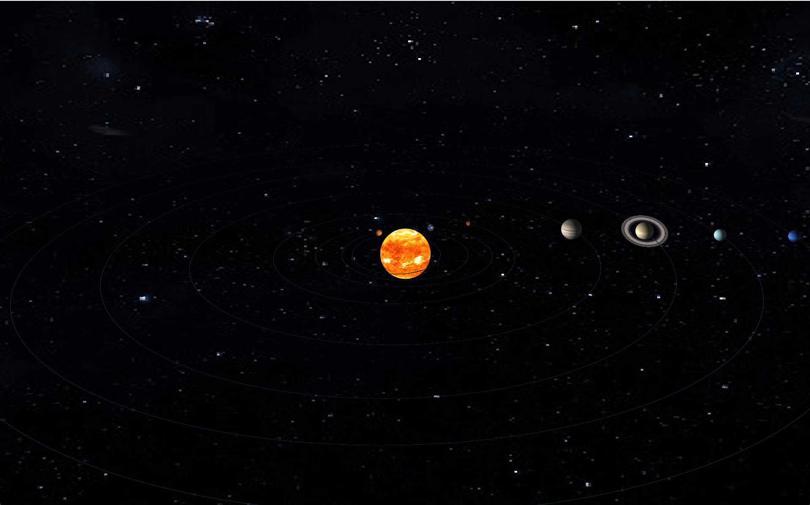

# Interactive 3D Solar System Simulator

A physics-based 3D Solar System simulation built from scratch using **Java** and **JavaFX**. The project combines a custom gravitational engine with deterministic orbital motion and an interactive "God Mode" sandbox.

## Academic Context

This project serves as a comprehensive showcase of the university knowledge acquired during my second year of studies. It practically applies core concepts from across multiple disciplines:
* **Computer Graphics**: 3D rendering pipelines, custom geometry generation (meshes), transformations, and texturing within the JavaFX environment.
* **Physics**: N-body gravitational mechanics, kinematics, and perfectly inelastic collision resolution.
* **Programming 2 (Java)**: Advanced object-oriented programming, strict MVC architecture, design patterns (Observer, Factory), and adherence to SOLID principles.
* **Algorithms & Data Structures**: Optimized simulation loops, node reuse strategies to prevent memory spikes, and efficient collection management for mapping 3D states.

## Overview & Features

* **N-Body Physics Engine**: Custom gravity calculations between all physical bodies with an iterative collision resolution system.
* **Mixed Motion Model**:
  * **Planets**: Fully dynamic, gravity-driven movement implementing `Kinematic`.
  * **Moons**: Host-centric parametric orbits for stable satellite motion (`OrbitingBody`).
  * **Stars**: Static, high-mass entities (`AnchoredBody`) that preserve their role even after collisions.
* **Cinematic Focus Mode**: Clicking on any celestial body automatically pauses the simulation and executes an adaptive camera zoom, filling the screen with the selected planet while displaying a detailed telemetry HUD.
* **Tactical Vector Map**: In the default panoramic view, all kinematic bodies display thin, semi-transparent holographic vectors representing their real-time velocity (green) and gravitational pull (red). These automatically hide during Focus Mode for a clean observation experience.
* **Aerospace HUD UI**: A completely custom, non-blocking interface modeled after high-tech Mission Control terminals, featuring glassmorphism effects, neon accents, and monospaced data fonts. Includes a "God Mode" (Creator Panel) to dynamically inject custom bodies into orbits and a temporal warp clock.
* **Complete Session Management**: Full state serialization to disk using a dedicated `SessionPersistenceService`. It captures the physical simulation state, camera transforms, and pause state, restoring everything perfectly on load.

## Architecture & Modules

The project is built on a clean MVC architecture with strong adherence to SOLID and Liskov Substitution principles:

* **Model (`astronomicalsystem.model`)**: Handles N-body physics, iterative perfectly inelastic collisions (conserving momentum), and structural interfaces (`Kinematic`, `OrbitingBody`, `AnchoredBody`).
* **View & Controller (`astronomicalsystem.view` / `controller`)**: Driven by `SimulationRenderer` and `InputHandler`. Implements strict parameter validations, dynamic node reuse for HUDs, adaptive camera calculations, and uses the Observer pattern for state updates.
* **Session Services (`astronomicalsystem.session`)**: Separated persistence layer (`SessionPersistenceService`, `SessionState`, `CameraState`) ensuring the main simulation loop remains lightweight. Backward compatible with legacy physical-only payloads.
* **Configuration (`astronomicalsystem.config`)**: Centralized `SimulationSettings` acts as the single source of truth for camera limits, render scales, visual radiuses, and physical constants.

## Testing & Quality Assurance

The project is covered by a JUnit Platform test suite that guarantees structural integrity and prevents regressions:
* **Physics & Kinematics**: Covered by `MoonTest` (Liskov-safe orbits) and `AstronomicalSystemCollisionTest` (iterative resolution and anchored body preservation).
* **Persistence**: Covered by `SessionPersistenceServiceTest` and `AstronomicalSystemPersistenceTest` for full state round-tripping.
* **UI & Validation**: Covered by `InputHandlerTest` and `SaturnRingTest`.

Run the suite using Gradle:

    ./gradlew test

## Performance Profiling

A built-in `SimulationPerformanceMonitor` is available to track frame times and rendering costs. This is an opt-in feature designed for debugging and optimizing large simulations. 
To enable lightweight profiling, run the application with the following system property:

    -Dastronomicalsystem.profile=true

## How to Use It

| Action | Input |
| :--- | :--- |
| **Rotate the view** | Left Click + Drag |
| **Move the camera** | Right Click + Drag / Shift + Left Click / Arrow Keys |
| **Zoom in/out** | Scroll Wheel or W / S |
| **System Menu** | P key (Resume, Save, Load, Quit) |
| **God Mode HUD** | C key (Spawn custom planets) |
| **Inspect planet (Focus Mode)** | Left Click on a planet |
| **Release Focus (Resume)** | R key / ESC key / Left Click empty space |

## Tech Stack & Execution

* **Language**: Java 21+
* **Framework**: JavaFX 21
* **Build Tool**: Gradle

### Getting Started

1. Ensure you have **JDK 21** or newer installed.
2. Clone the repository.
3. Build and test the project:

    ./gradlew build

4. Run the main class: `astronomicalsystem.Launcher` (or `astronomicalsystem.SolarSystem3D` depending on your IDE setup).

---

## License & Copyright

**Copyright © 2026 [D13GOOOO]. All Rights Reserved.**

This is a **proprietary** project.

* You are not allowed to copy, distribute, or modify this code for commercial use without explicit written permission from the author.
* This code is shared here for demonstration and portfolio purposes.

**Contact**: diego.guerini.it@gmail.com